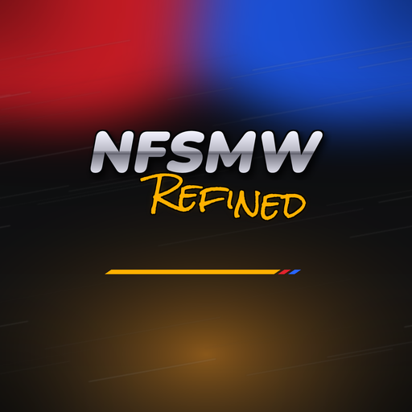

<div align="center">



# NFSMW Refined

**Need for Speed: Most Wanted (2005, PC) running natively on Android**

English only · offline · Mali support · Whole New UI Design

By **[prollynotzjay](https://github.com/prollynotzjay)**, based on
**[codepdbh/nfsmwpc-recompiled](https://github.com/codepdbh/nfsmwpc-recompiled)**

</div>

NFSMW Refined is a fork of codepdbh's static recompilation of the **PC version** of *Need for Speed: Most
Wanted* (2005, `speed.exe`, x86). Every function of the original executable is translated ahead of time from
x86 to C with [pcrecomp](https://github.com/sp00nznet/pcrecomp) and compiled for Android ARM64 / ARMv7.
It is **not** an emulator and **not** a port of the Xbox 360 version.

> No game files are included. You need your own copy of the PC game.

## What Refined changes

| | Original (Android Evolved) | NFSMW Refined |
|---|---|---|
| Language | Launcher in Spanish / English / Portuguese, game in any language | **English only**, launcher and game text |
| Online | EA Nation community server | **Removed**: offline, like the original game today. LAN races still work |
| GPU | Vulkan, custom Adreno drivers | **Mali profile**: detects Mali GPUs and applies tuned settings |
| Launcher | Two-column options screen | **New launcher design and layout** in Most Wanted colours |
| App | NFS Most Wanted Android Evolved | **NFSMW Refined**, its own package, installs next to the original |

## Playing

1. Install `NFSMW-Refined-arm64.apk` (Android 10+, Vulkan 1.1+).
2. Copy your PC installation into `Internal storage/nfsmw` so that `nfsmw/Speed.exe` sits next to
   `GLOBAL`, `TRACKS`, `CARS`, `FRONTEND`, `LANGUAGES`, `SOUND`, `MOVIES` and `NIS`.
   `LANGUAGES/English.bin` must be there: the game always runs in English.
   Add `d3dx9_26.dll` (DirectX runtime, from your Windows `SysWOW64`) and, for LAN hosting,
   `server.dll` and `server.cfg` from the game.
3. Open **NFSMW Refined**, allow file access and press **PLAY**.

### Launcher

The menu on the left works with touch or a controller (**A** select, **B** back, **START** play):

- **PLAY**: game file checks and the PLAY button.
- **GAME FILES**: where the files go and what is missing.
- **GRAPHICS & CONTROLS**: internal resolution, FPS limit, proportional widescreen HUD, minimap position,
  CPU/GPU latency, compressed textures, gamepad mode and, on Mali, the Mali profile.
- **DRIVER**: your GPU, the Vulkan driver test and (Adreno only) custom Turnip driver ZIPs.
- **ABOUT**: credits, updates and bug reports.

In game, the touch controls can be moved, resized and switched to classic, Xbox or PlayStation layouts,
or replaced by tilt steering or a Bluetooth/USB gamepad.

### Mali

On the first launch on a Mali GPU the launcher applies settings for it: textures converted on the CPU
(Mali has no BC/DXT compression), the phone's own Vulkan driver, and 720p / 60 FPS on Valhall and newer
(G57, G68, G610, G710, G615, G720, Immortalis) or 480p / 30 FPS on older Bifrost / Midgard (G52, G72, G76,
T8xx). Every option can still be changed, and **Mali profile** applies it again.

## Building

Requirements: Visual Studio with MSVC x86, Python 3 with `capstone` and `pefile`, the patched `pcrecomp` and
`nfsu2-recompiled` checked out next to this folder, and the game in `../Need for Speed Most Wanted 2005`.
The generated C code comes from your own `speed.exe` and is never committed.

```powershell
python scripts/analyze_binary.py            # writes work/speed.analysis.exe and work/binary.json
python scripts/data_seeds.py ...            # see docs/BINARY_REPORT.md for the full sequence
python scripts/run_lift.py catalog work/speed.analysis.exe work/seeds_code.json work/catalog.json
python scripts/run_lift.py lift work/speed.analysis.exe work/catalog.json src/recomp/gen
powershell -File scripts/build_windows.ps1
powershell -File scripts/test_windows.ps1   # windowed test run
```

Before building the APK, prepare the LAN server module from your own PC copy:

```powershell
python scripts/prepare_server.py "../Need for Speed Most Wanted 2005/server.dll"
```

Then build in `android/` with `gradlew assembleRelease` (add `-PnfsAbi=armeabi-v7a` for the 32-bit APK).
The APK is written as `android/app/build/outputs/apk/release/NFSMW-Refined-release.apk`.

The launcher icon, banner and backdrop are original artwork made by `android/tools/make_art.py`.

### Layout

```
config/    reference executable, forced seeds, hooks, overrides
scripts/   binary analysis, seed discovery, lift driver, Windows build/test
src/       Windows host, runtime adapters, Most Wanted shims
docs/      binary report, reuse audit, Android bring-up and audio notes
android/   Android app (launcher, touch controls, D3D9→Vulkan bridge, guest runtime)
work/      (local only) analysis copy, catalog, logs
```

## Credits

- **codepdbh**: the original recompilation, Android runtime and port
  ([nfsmwpc-recompiled](https://github.com/codepdbh/nfsmwpc-recompiled)).
- **prollynotzjay**: NFSMW Refined: English-only, offline, Mali profile, launcher and artwork.
- **sp00nznet**: pcrecomp. Proportional HUD adaptation follows ThirteenAG's WidescreenFix
  ([notice](THIRD_PARTY_NOTICES.md)).
- Fonts: Nunito (SIL OFL) and Rock Salt (Apache 2.0), in `android/app/src/main/assets/fonts`.

*Need for Speed* is a trademark of Electronic Arts. This project is not affiliated with EA and includes no
game files.
